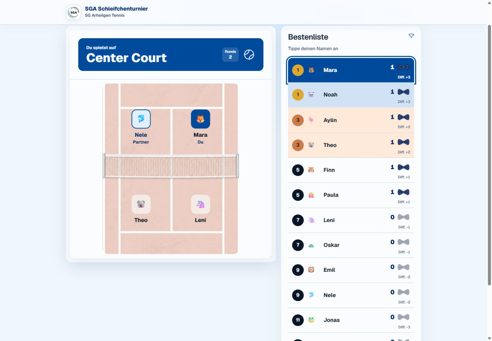
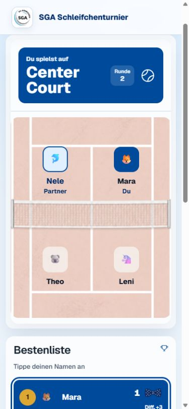
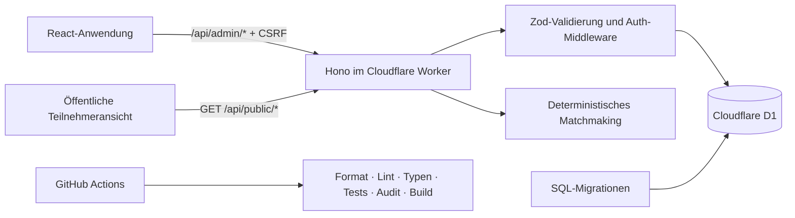

# SGA Schleifchenturnier

Eine deutschsprachige Full-Stack-Anwendung zur Durchführung eines zeitgesteuerten Tennis-Doppelturniers. Die Turnierleitung verwaltet Teilnehmende und Plätze, veröffentlicht faire Paarungen, steuert Runden und erfasst Ergebnisse. Gäste öffnen eine speziell für Mobilgeräte gestaltete Leseansicht per Link oder QR-Code – ohne Konto und ohne App-Installation.

> Portfolio-Repository: Der Quellcode ist öffentlich einsehbar, es gibt bewusst keine öffentliche Live-Demo und keine veröffentlichten Zugangsdaten.



<p align="center">
  
</p>

## Was das Projekt zeigt

- komplette Turnierverwaltung von der Veranstaltung bis zur Ergebnis-Historie
- feste Rundenanzahl oder manuelles Turnierende, mit öffentlicher Endwertung und späterer Fortsetzung
- manuelle Rundenaufstellung mit frei gewählten Doppeln, Plätzen und Aussetzenden; veröffentlichte Paarungen sind vor dem Start bearbeitbar
- deterministisches Matchmaking mit fairer Aussetzerverteilung und Wiederholungsvermeidung
- responsive Teilnehmeransicht mit persönlicher Platz-, Partner- und Gegnerzuordnung
- Worker-API mit validierten Nutzdaten, signierten Sitzungen und CSRF-Schutz
- relationales D1-Datenmodell mit versionierten SQL-Migrationen und atomaren Schreibvorgängen
- Unit-, Charakterisierungs- und Worker-Integrationstests gegen ein echtes migriertes D1-Schema
- reproduzierbare Qualitätsprüfung und GitHub-Actions-Pipeline

## Technischer Stack

| Bereich      | Technologien                                                        | Aufgabe                                                            |
| ------------ | ------------------------------------------------------------------- | ------------------------------------------------------------------ |
| UI           | React 19, TypeScript, React Router                                  | komponentenbasierte Admin- und Teilnehmeroberfläche                |
| Designsystem | Tailwind CSS 4, shadcn/ui, Radix UI, Phosphor Icons, Geist Variable | zugängliche Komponenten, Tokens und responsive Gestaltung          |
| Build        | Vite 7, Cloudflare Vite Plugin                                      | lokaler Full-Stack-Server und optimierter Produktions-Build        |
| API          | Cloudflare Workers, Hono, Zod                                       | Edge-Routing, Middleware und Eingabevalidierung                    |
| Daten        | Cloudflare D1 / SQLite, SQL-Migrationen                             | Veranstaltungen, Plätze, Spieler, Runden und Matches               |
| Sicherheit   | Web Crypto API, HttpOnly-Cookie, HMAC, CSRF-Token                   | geschützte Turnierleitung ohne clientseitig gespeichertes Passwort |
| Qualität     | Vitest, Cloudflare Vitest Integration, ESLint, Prettier, TypeScript | Verhalten, Runtime-Integration und statische Qualität              |
| Betrieb      | Wrangler, GitHub Actions                                            | Typgenerierung, Migration, Audit, Build und Deployment             |

## Architektur



Der Worker liefert sowohl die API als auch die gebauten statischen Dateien aus. Dadurch teilen Frontend und Backend ein Deployment, während die öffentliche und die administrative HTTP-Schnittstelle klar getrennt bleiben. Details stehen in [docs/ARCHITEKTUR.md](docs/ARCHITEKTUR.md).

## Schnellstart

Voraussetzungen: Node.js 22 oder neuer und npm.

```powershell
npm install
Copy-Item .dev.vars.example .dev.vars
npm run db:migrate:local
npm run db:seed:demo # optional, nur lokale erfundene Portfolio-Daten
npm run dev
```

Das lokale Passwort wird ausschließlich in der ignorierten Datei `.dev.vars` gesetzt. Die vom Entwicklungsserver ausgegebene URL öffnet die Anwendung; die Demo-Teilnehmeransicht liegt unter `/event/sommerfest-demo`.

## Qualitätschecks

```powershell
npm run format:check
npm run lint
npm run typecheck
npm test
npm run audit:production
npm run build
```

`npm run check` führt Formatprüfung, Lint, Typprüfung, sämtliche Tests und den Build nacheinander aus. Die Worker-Integrationstests wenden die echten Migrationen auf eine isolierte D1-Instanz an.

## Konfiguration und Deployment

Die Cloudflare-Ressourcen stehen in `wrangler.jsonc`; Geheimnisse gehören nicht ins Repository. Vor einem eigenen Deployment müssen eine D1-Datenbank angelegt, deren ID eingetragen und `ADMIN_PASSWORD` sowie `SESSION_SECRET` als Wrangler-Secrets gesetzt werden. Danach:

```powershell
npm run db:migrate:remote
npm run deploy
```

Die genaue Entwicklungskette, CI, Deployment- und Rollback-Schritte beschreibt [docs/ENTWICKLUNG.md](docs/ENTWICKLUNG.md).

## Bewusste Produktgrenzen

- ein vertrauenswürdiges Organisationsteam statt mehrerer Benutzerrollen
- keine Selbstregistrierung, E-Mail-Zustellung oder Passwort-Wiederherstellung
- öffentliche Ansicht ausschließlich lesend; Ergebnisse werden nur administrativ erfasst
- keine Live-Demo, Telemetrie oder produktiven Daten im Portfolio-Repository
- optimiert für ein zeitlich begrenztes Vereinsereignis, nicht als mandantenfähige Turnierplattform

## Weitere Dokumente

- [Technische Architektur](docs/ARCHITEKTUR.md)
- [Entwicklung und Betrieb](docs/ENTWICKLUNG.md)
- [Produktprinzipien](PRODUCT.md)
- [Frontend-Designsystem](DESIGN.md)
- [Rechtehinweis](RECHTE.md)

## Rechte

Es wird keine Open-Source-Lizenz erteilt. Der Code ist für Portfolio- und Bewerbungszwecke öffentlich einsehbar. Vereinslogo, Vereinsname sowie enthaltenes Marken- und Bildmaterial sind von einer Nutzungserlaubnis ausdrücklich ausgenommen. Maßgeblich ist [RECHTE.md](RECHTE.md).
