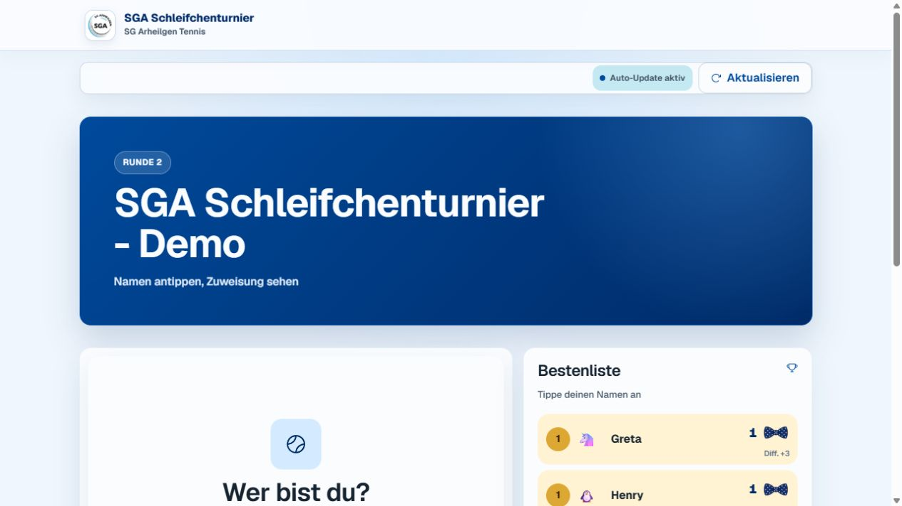
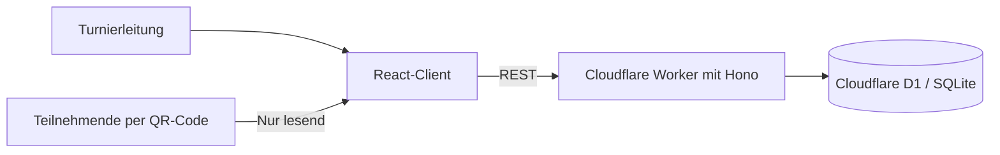

# SGA Schleifchenturnier

Full-Stack-Webanwendung zur Organisation eines zeitgesteuerten Tennis-Doppelturniers. Die Turnierleitung verwaltet Anmeldung, Plätze, Runden, Matchmaking und Ergebnisse. Teilnehmende öffnen per QR-Code eine mobile Ansicht und sehen ihren Platz, Partner, Gegner sowie die aktuelle Bestenliste.

**[Live-Demo öffnen](https://sga-schleifchenturnier-demo.sga-events.workers.dev/event/demo-sommerfest-2026)** · [Spieleransicht](design-screenshots/demo-player-assignment.png) · [Admin-Dashboard](design-screenshots/courts-desktop.png)

> Die Live-Demo verwendet ausschließlich künstliche Beispieldaten. Die öffentliche Teilnehmeransicht ist schreibgeschützt; der Adminbereich ist durch ein nicht veröffentlichtes Passwort geschützt.



## Funktionen

- Turniere mit Datum, Rundendauer und individuellen Plätzen anlegen
- Teilnehmende registrieren, aktivieren und verwalten
- faire Doppelbegegnungen mit reproduzierbarem, lexikografisch bewertetem Matchmaking erzeugen
- Runden veröffentlichen, starten, pausieren und abschließen
- Ergebnisse erfassen und eine Bestenliste aus Siegen und Spieldifferenz berechnen
- mobile Teilnehmeransicht per öffentlichem Link oder QR-Code bereitstellen
- Adminzugriff über signierte HTTP-only-Sitzungen und CSRF-Prüfung schützen

## Architektur



| Bereich | Umsetzung |
| --- | --- |
| Frontend | React 19, TypeScript, Vite, Radix UI, responsive Teilnehmeransicht |
| Backend | Cloudflare Workers, Hono, REST-Endpunkte, Zod-Validierung |
| Daten | Cloudflare D1, SQL-Migrationen, vorbereitete Statements |
| Sicherheit | signierte HTTP-only-Cookies, CSRF-Schutz, konstante Passwortprüfung |
| Qualität | Vitest, TypeScript-Typecheck, reproduzierbarer Produktions-Build |

## Mein Beitrag

Das Projekt wurde von mir als privates Full-Stack-Projekt konzipiert und umgesetzt. Dazu gehörten Produktablauf, UI, API- und Datenmodell, Matchmaking-Logik, Tests sowie die Bereitstellung auf Cloudflare.

## Lokale Entwicklung

Voraussetzungen: Node.js 20 oder neuer und npm.

```powershell
npm install
Copy-Item .dev.vars.example .dev.vars
npm run db:migrate:local
npm run dev
```

Vor dem Start müssen die Platzhalter in `.dev.vars` durch lokale Entwicklungswerte ersetzt werden. Diese Datei ist von Git ausgeschlossen.

## Qualitätssicherung

```powershell
npm run typecheck
npm test
npm run build
```

Der aktuelle Stand umfasst 39 automatisierte Tests für Matchmaking, Adminrichtlinien, Routen und UI-Zustände.

## Demo-Umgebung

Die Demo läuft als eigener Worker mit separater D1-Datenbank und künstlichen Seed-Daten:

```powershell
npm run db:migrate:demo
npm run db:seed:demo
npm run deploy:demo
```

Produktions- und Demo-Daten werden nicht gemeinsam verwendet. Secrets werden ausschließlich über Wrangler gesetzt und nicht im Repository gespeichert.
