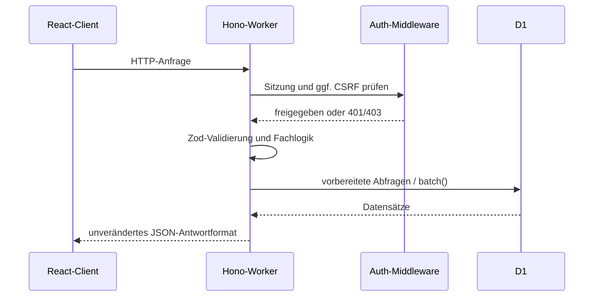
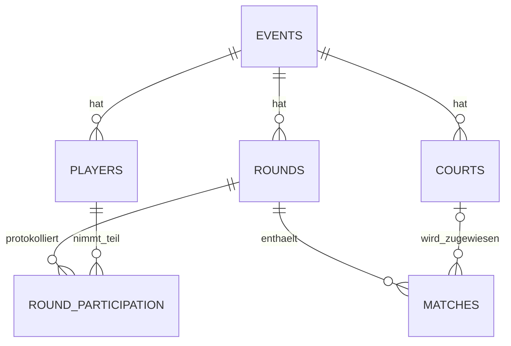
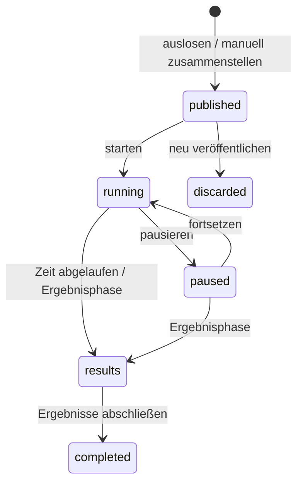
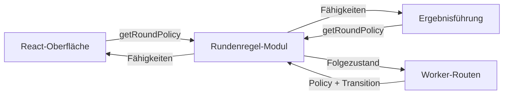
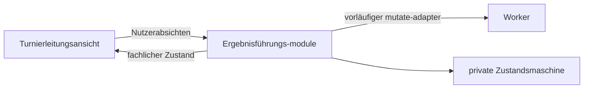

# Technische Architektur

## Systemüberblick

Die Anwendung ist ein gemeinsam deploytes Full-Stack-System. Vite baut die React-Oberfläche; das Cloudflare-Plugin verbindet sie lokal und im Deployment mit einem Hono-Worker. API-Anfragen unter `/api/*` laufen zuerst durch den Worker, übrige Routen fallen auf die Single-Page-Anwendung zurück. D1 ist die einzige dauerhafte Datenquelle.

## Modulgrenzen

### Client

- `src/App.tsx`: Routing, Anmeldung und Veranstaltungsübersicht
- `src/components/app-shell.tsx`: gemeinsame Anwendungshülle und Zustandsanzeigen
- `src/features/admin/`: Turnierleitung, Ergebnisdialoge und Verwaltungskomponenten
- `src/features/admin/ManualRoundEditor.tsx`: lokaler Entwurf für Doppel, Plätze und Aussetzende mit Abbruchschutz
- `src/features/admin/results/`: deep module für die Ergebnisführung mit den interfaces `useRoundResults` und `useResultCorrection`
- `src/features/public/`: öffentliche, mobile Teilnehmeransicht
- `src/features/tournament/`: gemeinsam genutzte Turnierdarstellung
- `src/domain/round-rules.ts`: gemeinsames Rundenregel-Modul für Client und Worker
- `src/domain/event-rules.ts`: gemeinsame Regeln für Rundenlimit, Turnierabschluss, Fortsetzung und Konfigurationssperren
- `src/domain/tournament.ts`: zentrale DTOs für Events, Spieler, Plätze, Runden und Matches
- `src/lib/api.ts`: eine zentrale Fetch-/CSRF-Implementierung
- `src/styles/`: Basis-, Admin-, Public- und nachgelagerte Polish-Regeln

### Worker

- `worker/index.ts`: App-Komposition, Validierung und fachliche Routen
- `worker/auth.ts`: Login, Sitzung, Cookie und Admin-Middleware
- `worker/crypto.ts`: Base64url, HMAC und zeitkonstanter Vergleich
- `worker/event-data.ts`: Datenzugriff und Aufbau des Event-DTOs
- `worker/event-mutations.ts`: Event-Snapshot und atomare Versionsprüfung für Konfiguration und Lebenszyklusänderungen
- `worker/matchmaker.ts`: reines, deterministisches Matchmaking
- `worker/player-emojis.ts`: deterministische Emoji-Vergabe
- `worker/round-publication.ts`: gemeinsamer atomarer Speicherweg für ausgeloste und manuelle Runden

`worker-configuration.d.ts` wird aus `wrangler.jsonc` erzeugt und ist die zentrale Typquelle für Worker-Bindings.

## HTTP-API

Alle Nutzdaten bleiben JSON; die bestehende URL-Struktur, Statuscodes und Antwortformen sind die öffentliche Kompatibilitätsgrenze.

| Methode          | Route                                 | Zweck                                          | Schutz                   |
| ---------------- | ------------------------------------- | ---------------------------------------------- | ------------------------ |
| POST             | `/api/auth/login`                     | Admin-Sitzung anlegen                          | Passwort                 |
| POST             | `/api/auth/logout`                    | Cookie entfernen                               | –                        |
| GET              | `/api/auth/session`                   | Sitzungsstatus und CSRF-Token                  | Cookie optional          |
| GET/POST         | `/api/admin/events`                   | Veranstaltungen lesen/anlegen                  | Sitzung, bei POST CSRF   |
| GET/PATCH/DELETE | `/api/admin/events/:id`               | Veranstaltung lesen/ändern/löschen             | Sitzung, schreibend CSRF |
| POST             | `/api/admin/events/:id/players`       | Spieler anlegen                                | Sitzung + CSRF           |
| PATCH            | `/api/admin/players/:id`              | Name/Aktivität ändern                          | Sitzung + CSRF           |
| POST             | `/api/admin/events/:id/courts`        | Platz anlegen                                  | Sitzung + CSRF           |
| PATCH/DELETE     | `/api/admin/courts/:id`               | Platz ändern/löschen                           | Sitzung + CSRF           |
| POST             | `/api/admin/events/:id/generate`      | Runde auslosen und veröffentlichen             | Sitzung + CSRF           |
| POST             | `/api/admin/events/:id/rounds/manual` | Vollständige manuelle Runde veröffentlichen    | Sitzung + CSRF           |
| POST             | `/api/admin/rounds/:id/action`        | starten, pausieren, fortsetzen                 | Sitzung + CSRF           |
| PUT              | `/api/admin/matches/:id/result`       | Ergebnis setzen oder korrigieren               | Sitzung + CSRF           |
| POST             | `/api/admin/rounds/:id/complete`      | Runde abschließen                              | Sitzung + CSRF           |
| POST             | `/api/admin/events/:id/finish`        | Turnier zwischen Runden beenden                | Sitzung + CSRF           |
| POST             | `/api/admin/events/:id/resume`        | Beendetes Turnier mit neuer Planung fortsetzen | Sitzung + CSRF           |
| GET              | `/api/public/events/:slug`            | öffentliche Leseansicht                        | öffentlich               |

## Datenmodell

- `events` enthält öffentliche Slugs, Standarddauer und Lebenszyklusstatus.
- `planned_round_count` ist die feste Gesamtzahl der Runden; `NULL` bedeutet „Selbst beenden“. `finished_at` kennzeichnet den Turnierabschluss unabhängig vom Archivstatus. `revision` schützt Konfiguration und Lebenszyklus vor konkurrierenden Änderungen.
- `players` speichert eventbezogen eindeutige Emoji-Identitäten und Aktivität.
- `courts` hält stabile Namen und Positionen; Matches bewahren zusätzlich einen Namens-Snapshot.
- `rounds` bildet Nummer, Laufzeit, Zeitstempel und Matchmaking-Seed ab.
- `matches` referenziert vier Spieler und optional ein Ergebnis.
- `round_participation` hält Spielen/Aussetzen pro Runde fest.

Migrationen liegen unveränderlich nummeriert unter `migrations/`. Mehrteilige fachliche Änderungen werden mit `D1Database.batch()` atomar geschrieben, etwa Runde, Matches und Teilnahmeprotokoll oder Abschluss und Ergebnis-Sperrzeitpunkt.

## Authentifizierung und CSRF

Nach erfolgreichem Passwortvergleich erzeugt der Worker eine zwölf Stunden gültige Sitzung. Ihr Payload enthält Ablaufzeit und zufälligen CSRF-Wert; HMAC-SHA-256 signiert den Base64url-Payload mit `SESSION_SECRET`. Das Token liegt in einem `HttpOnly`, `Secure`, `SameSite=Lax` Cookie. Signaturen und Passwort werden zeitkonstant verglichen.

Die Admin-Middleware prüft bei jeder geschützten Anfrage Cookie, Signatur und Ablaufzeit. Für alle Methoden außer `GET` und `HEAD` muss der Client zusätzlich denselben CSRF-Wert im Header `x-csrf-token` senden. Dadurch kann fremder Seiteninhalt das Cookie nicht allein für Schreibvorgänge missbrauchen.

## Rundenstatus

`src/domain/round-rules.ts` bildet an einer gemeinsamen seam die fachlichen Fähigkeiten jedes Zustands und die gültigen Übergänge ab. Das kleine interface besteht aus `getRoundPolicy(state)` und `getRoundTransition(state, action)`. React nutzt die Policy für sichtbare Möglichkeiten; der Worker erzwingt dieselben Regeln unabhängig von der Darstellung.

Während einer offenen Runde sind Teilnehmer- und Platzkonfiguration gesperrt. Ergebniseingabe ist in `running`, `paused` und `results` möglich; gespeicherte Ergebnisse abgeschlossener Runden bleiben korrigierbar. `discarded` gehört zum persistenten Lebenszyklus, wird aber nicht als aktuelle Runde im Event-DTO ausgeliefert. Zeitberechnung, SQL und Darstellung bleiben bewusst bei ihren jeweiligen Aufrufern, damit das Regel-Modul reine Berechnung ohne I/O bleibt.

## Turnierabschluss und Rundenplanung

Erstellen und Einstellungen akzeptieren `plannedRoundCount` als positive Ganzzahl oder `null`. Fehlende Angaben beim Erstellen bleiben für bestehende Aufrufer unbegrenzt. Eine Änderung ist nur vor der ersten Veröffentlichung oder zwischen abgeschlossenen Runden erlaubt; eine feste Gesamtzahl muss oberhalb der abgeschlossenen Rundenzahl liegen. Die Standarddauer bleibt während einer offenen Runde für Folgerunden änderbar.

Der Abschluss der letzten geplanten Runde schreibt Rundenzustand und `finished_at` gemeinsam. Zeitablauf und das Speichern eines Ergebnisses beenden das Turnier nicht. `/finish` erlaubt den vorzeitigen Abschluss nach mindestens einer gewerteten Runde, solange keine Runde offen ist. `/resume` verlangt eine neue gültige Planung und entfernt den Abschlusszeitpunkt; archivierte Turniere bleiben davon ausgeschlossen.

Die öffentliche Ansicht zeigt bei `finished_at` die Endwertung und aktualisiert sich weiter, damit Berichtigungen und eine spätere Fortsetzung sichtbar werden. Teilnehmer- und Platzkonfiguration sowie neue Runden sind bei Abschluss oder Archivierung gesperrt. Ergebnisberichtigungen bleiben wie bisher möglich. Die Bestenliste berücksichtigt weiterhin bereits gespeicherte Spielergebnisse vor dem Rundenabschluss.

Einstellungen, Auslosung, Rundenaktionen, Rundenabschluss, `/finish` und `/resume` akzeptieren optional `expectedRevision`. Die neuen Planungsdialoge und Auslosung senden die angezeigte Version; bestehende Aufrufer bleiben ohne dieses Feld nutzbar. Unabhängig davon beginnt jeder Konfigurations- und Lebenszyklusschreibvorgang mit einer Versionsprüfung im selben D1-Batch. Bei Abweichung verletzt die Prüfung gezielt den benannten Constraint `event_revision_conflict`: D1 rollt den gesamten Batch zurück, der Worker antwortet mit HTTP 409 und `code: "event_conflict"`. Ein gewöhnliches bedingtes UPDATE würde nur null Zeilen ändern und nachfolgende Statements trotzdem zulassen.

Spielstandänderungen erhöhen diese Version bewusst nicht, damit parallele Ergebniseingaben auf verschiedenen Plätzen unabhängig bleiben. Veraltete Planungsdialoge behalten ihre Eingaben und übernehmen keine neue Version stillschweigend; nach einem Konflikt müssen sie geschlossen und erneut geöffnet werden.

## Manuelle Rundenaufstellung

Der Editor verwaltet nur einen lokalen Entwurf. Er zeigt aktive Teilnehmer alphabetisch mit Emoji, verhindert doppelte Auswahl und berechnet „Setzen aus“ aus allen nicht eingeteilten aktiven Teilnehmern. Veröffentlichen erfordert mindestens einen vollständig besetzten Platz. Eine veröffentlichte, noch nicht gestartete Runde kann als Vorlage geöffnet und nach Bearbeitung unter derselben Rundennummer ersetzt werden. Ein geänderter Entwurf wird beim Schließen oder Navigieren nicht ohne Rückfrage verworfen.

`POST /api/admin/events/:id/rounds/manual` erhält Platz-IDs und je zwei Spieler-IDs für beide Teams sowie die angezeigte `expectedRevision`. Der Worker prüft jede ID gegen aktive Plätze und Spieler der Veranstaltung, vollständige Vierergruppen sowie eindeutige Belegung. Die übrigen aktiven Spieler schreibt er selbst als Aussetzende. Ein ungültiger Entwurf verändert die veröffentlichte Runde nicht.

Auslosung und manuelle Eingabe rufen beide `publishRound` auf. Dieser Weg schreibt die neue Runde, Matches mit Platznamen-Snapshots, Teilnahmeprotokoll und gegebenenfalls das Verwerfen der bisherigen veröffentlichten Runde atomar mit der Versionsprüfung. Nach dem Rundenabschluss landen manuelle Paarungen in derselben Partner- und Gegnerhistorie wie ausgeloste. Die Aussetzerprognose in der Teilnehmerverwaltung bezieht sich weiterhin ausdrücklich auf die automatische Auslosung.

## Ergebnisführung

Die Turnierleitungsansicht überschreitet die Ergebnis-seam über zwei interfaces: `useRoundResults` für die laufende Runde und `useResultCorrection` für spätere Korrekturen. Beide verwenden dieselbe private Zustandsmaschine. Ihre implementation hält Entwurf, bestätigten Stand, laufenden Schreibvorgang und Fehlerzustand zusammen.

Schreibvorgänge werden pro Match serialisiert. Ändert die Turnierleitung einen Spielstand während des Speicherns erneut, bestätigt die Antwort nur den tatsächlich versendeten Snapshot; danach wird der neueste gültige Entwurf gespeichert. Verschiedene Matches dürfen weiterhin parallel speichern. Das interface ist zugleich die Testfläche und wird mit React Testing Library geprüft.

## Matchmaking

Die Funktion erhält aktive Spieler, verfügbare Plätze, bisherige Paarungen und einen Seed. Zuerst wird die Kapazität auf volle Vierergruppen begrenzt. Aussetzende werden primär nach der bisher kleinsten Aussetzerzahl ausgewählt; der Seed löst Gleichstände reproduzierbar auf.

Für die Spielenden werden bis zu 2.500 Kandidaten erzeugt. Jede Teamaufteilung erhält einen vierteiligen Score, der lexikografisch minimiert wird:

1. wiederholte Partnerschaften
2. wiederholte Gegnerbegegnungen
3. größte Rangspannweite innerhalb eines Courts
4. Differenz der addierten Teamränge

Damit hat Wiederholungsvermeidung bewusst Vorrang vor einer feineren Spielstärkebalance. Gleicher Datenstand plus gleicher Seed liefert dieselbe Auslosung; Unit-Tests sichern diese Deterministik.

## Fehlergrenzen und Protokollierung

Erwartete Validierungs- und Zustandsfehler erhalten stabile 4xx-Antworten. Unerwartete Fehler werden strukturiert mit Methode und Pfad protokolliert; die Antwort gibt keine internen Details preis. Produktive Observability wird in diesem Portfolio-Repository nicht automatisch aktiviert, weil dies eine Änderung der produktiven Cloudflare-Konfiguration wäre.
