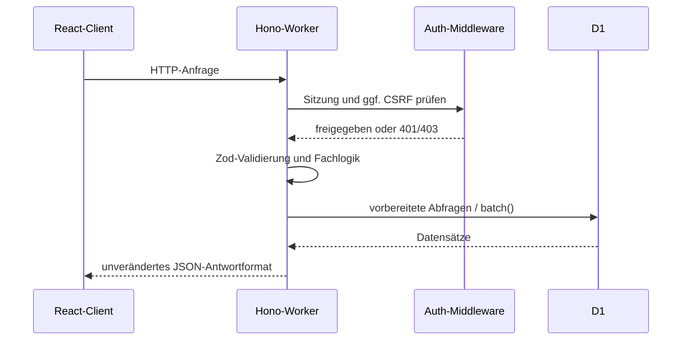
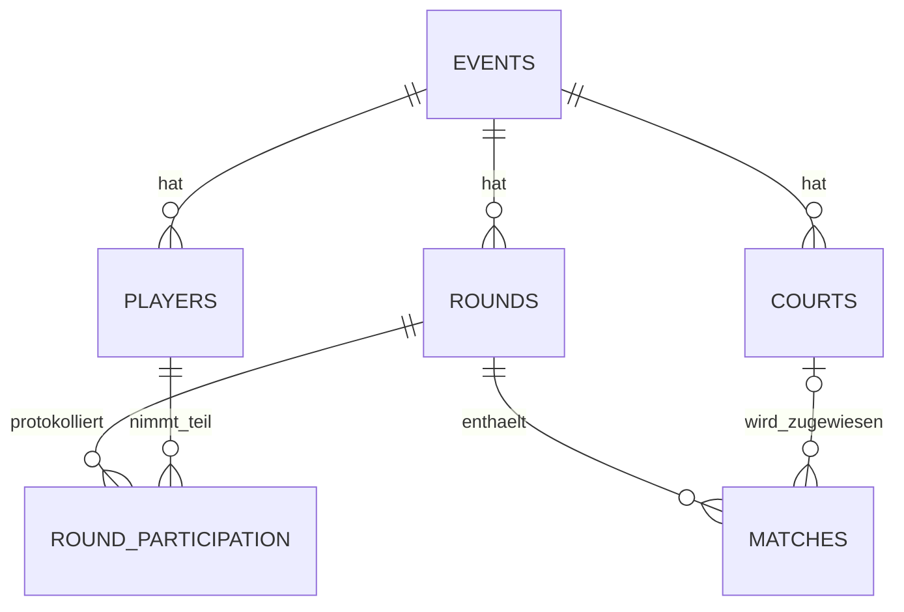
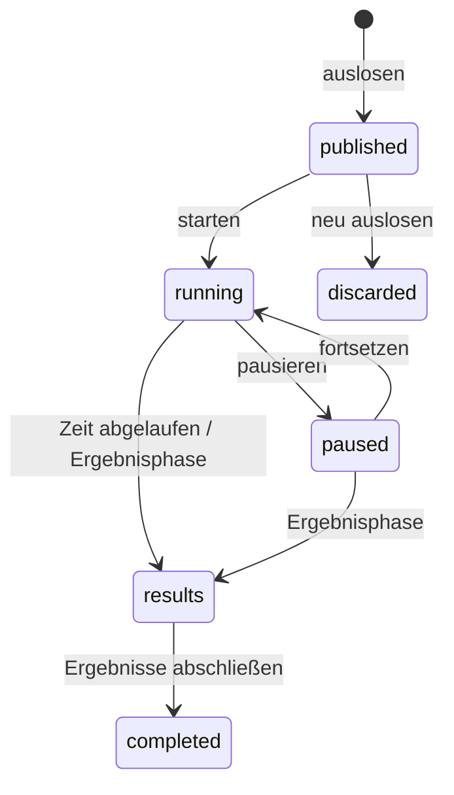

# Technische Architektur

## Systemüberblick

Die Anwendung ist ein gemeinsam deploytes Full-Stack-System. Vite baut die React-Oberfläche; das Cloudflare-Plugin verbindet sie lokal und im Deployment mit einem Hono-Worker. API-Anfragen unter `/api/*` laufen zuerst durch den Worker, übrige Routen fallen auf die Single-Page-Anwendung zurück. D1 ist die einzige dauerhafte Datenquelle.

## Modulgrenzen

### Client

- `src/App.tsx`: Routing, Anmeldung und Veranstaltungsübersicht
- `src/components/app-shell.tsx`: gemeinsame Anwendungshülle und Zustandsanzeigen
- `src/features/admin/`: Turnierleitung, Ergebnisdialoge und Verwaltungskomponenten
- `src/features/public/`: öffentliche, mobile Teilnehmeransicht
- `src/features/tournament/`: gemeinsam genutzte Turnierdarstellung
- `src/domain/tournament.ts`: zentrale DTOs für Events, Spieler, Plätze, Runden und Matches
- `src/lib/api.ts`: eine zentrale Fetch-/CSRF-Implementierung
- `src/styles/`: Basis-, Admin-, Public- und nachgelagerte Polish-Regeln

### Worker

- `worker/index.ts`: App-Komposition, Validierung und fachliche Routen
- `worker/auth.ts`: Login, Sitzung, Cookie und Admin-Middleware
- `worker/crypto.ts`: Base64url, HMAC und zeitkonstanter Vergleich
- `worker/event-data.ts`: Datenzugriff und Aufbau des Event-DTOs
- `worker/matchmaker.ts`: reines, deterministisches Matchmaking
- `worker/admin-policy.ts`: Regeln für gesperrte Konfiguration
- `worker/player-emojis.ts`: deterministische Emoji-Vergabe

`worker-configuration.d.ts` wird aus `wrangler.jsonc` erzeugt und ist die zentrale Typquelle für Worker-Bindings.

## HTTP-API

Alle Nutzdaten bleiben JSON; die bestehende URL-Struktur, Statuscodes und Antwortformen sind die öffentliche Kompatibilitätsgrenze.

| Methode          | Route                            | Zweck                              | Schutz                   |
| ---------------- | -------------------------------- | ---------------------------------- | ------------------------ |
| POST             | `/api/auth/login`                | Admin-Sitzung anlegen              | Passwort                 |
| POST             | `/api/auth/logout`               | Cookie entfernen                   | –                        |
| GET              | `/api/auth/session`              | Sitzungsstatus und CSRF-Token      | Cookie optional          |
| GET/POST         | `/api/admin/events`              | Veranstaltungen lesen/anlegen      | Sitzung, bei POST CSRF   |
| GET/PATCH/DELETE | `/api/admin/events/:id`          | Veranstaltung lesen/ändern/löschen | Sitzung, schreibend CSRF |
| POST             | `/api/admin/events/:id/players`  | Spieler anlegen                    | Sitzung + CSRF           |
| PATCH            | `/api/admin/players/:id`         | Name/Aktivität ändern              | Sitzung + CSRF           |
| POST             | `/api/admin/events/:id/courts`   | Platz anlegen                      | Sitzung + CSRF           |
| PATCH/DELETE     | `/api/admin/courts/:id`          | Platz ändern/löschen               | Sitzung + CSRF           |
| POST             | `/api/admin/events/:id/generate` | Runde auslosen und veröffentlichen | Sitzung + CSRF           |
| POST             | `/api/admin/rounds/:id/action`   | starten, pausieren, fortsetzen     | Sitzung + CSRF           |
| PUT              | `/api/admin/matches/:id/result`  | Ergebnis setzen oder korrigieren   | Sitzung + CSRF           |
| POST             | `/api/admin/rounds/:id/complete` | Runde abschließen                  | Sitzung + CSRF           |
| GET              | `/api/public/events/:slug`       | öffentliche Leseansicht            | öffentlich               |

## Datenmodell

- `events` enthält öffentliche Slugs, Standarddauer und Lebenszyklusstatus.
- `players` speichert eventbezogen eindeutige Emoji-Identitäten und Aktivität.
- `courts` hält stabile Namen und Positionen; Matches bewahren zusätzlich einen Namens-Snapshot.
- `rounds` bildet Nummer, Laufzeit, Zeitstempel und Matchmaking-Seed ab.
- `matches` referenziert vier Spieler und optional ein Ergebnis.
- `round_participation` hält Spielen/Aussetzen pro Runde fest.

Migrationen liegen unveränderlich nummeriert unter `migrations/`. Mehrteilige fachliche Änderungen werden mit `D1Database.batch()` atomar geschrieben, etwa Runde, Matches und Teilnahmeprotokoll oder Abschluss und Ergebnis-Sperrzeitpunkt.

## Authentifizierung und CSRF

Nach erfolgreichem Passwortvergleich erzeugt der Worker eine zwölf Stunden gültige Sitzung. Ihr Payload enthält Ablaufzeit und zufälligen CSRF-Wert; HMAC-SHA-256 signiert den Base64url-Payload mit `SESSION_SECRET`. Das Token liegt in einem `HttpOnly`, `Secure`, `SameSite=Lax` Cookie. Signaturen und Passwort werden zeitkonstant verglichen.

Die Admin-Middleware prüft bei jeder geschützten Anfrage Cookie, Signatur und Ablaufzeit. Für alle Methoden außer `GET` und `HEAD` muss der Client zusätzlich denselben CSRF-Wert im Header `x-csrf-token` senden. Dadurch kann fremder Seiteninhalt das Cookie nicht allein für Schreibvorgänge missbrauchen.

## Rundenstatus

Während einer offenen Runde sind Teilnehmer- und Platzkonfiguration gesperrt. Der Server entscheidet diese Grenze unabhängig von der Darstellung. Bereits gespeicherte Ergebnisse bleiben entsprechend dem Referenzverhalten korrigierbar.

## Matchmaking

Die Funktion erhält aktive Spieler, verfügbare Plätze, bisherige Paarungen und einen Seed. Zuerst wird die Kapazität auf volle Vierergruppen begrenzt. Aussetzende werden primär nach der bisher kleinsten Aussetzerzahl ausgewählt; der Seed löst Gleichstände reproduzierbar auf.

Für die Spielenden werden bis zu 2.500 Kandidaten erzeugt. Jede Teamaufteilung erhält einen vierteiligen Score, der lexikografisch minimiert wird:

1. wiederholte Partnerschaften
2. wiederholte Gegnerbegegnungen
3. größte Rangspannweite innerhalb eines Courts
4. Differenz der addierten Teamränge

Damit hat Wiederholungsvermeidung bewusst Vorrang vor einer feineren Spielstärkebalance. Gleicher Datenstand plus gleicher Seed liefert dieselbe Auslosung; Unit-Tests sichern diese Deterministik.

## Fehlergrenzen und Protokollierung

Erwartete Validierungs- und Zustandsfehler erhalten stabile 4xx-Antworten. Unerwartete Fehler werden strukturiert mit Methode und Pfad protokolliert; die Antwort gibt keine internen Details preis. Produktive Observability wird in diesem Portfolio-Repository nicht automatisch aktiviert, weil dies eine Änderung der produktiven Cloudflare-Konfiguration wäre.
